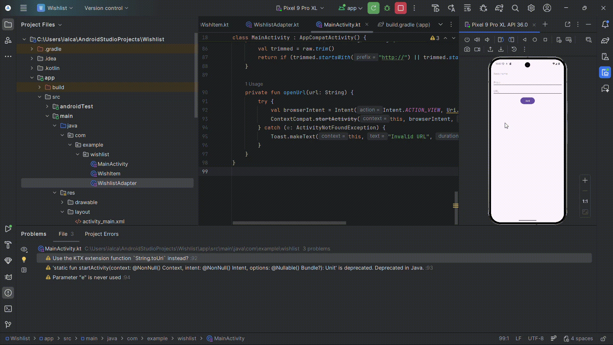

# Wishlist

A simple Android wishlist app where you add things you want to buy with a price and a link. I built it for CodePath's Android course.

## What it does

- Add an item with a name, a price, and a URL. The app shows a message if any field is missing or the price isn't a number.
- Items appear in a list with the price formatted in dollars.
- Tap an item to open its link in the browser. Links without `http://` or `https://` get `https://` added.
- Long-press an item to delete it.

## Tech stack

Kotlin, Android SDK (min SDK 24), RecyclerView.

## How to run it

1. Clone the repo and open it in Android Studio.
2. Let Gradle sync, then run the `app` configuration on an emulator or a device.

## Limitations

The list lives in memory only, so it's cleared when the app closes.
